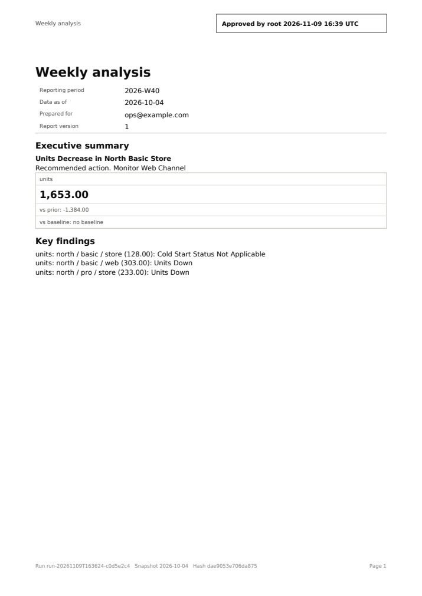
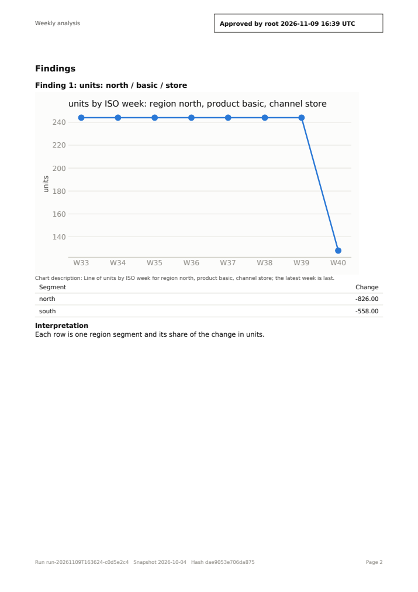
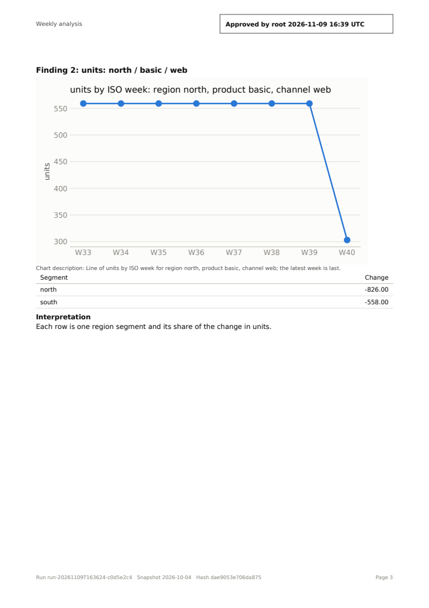
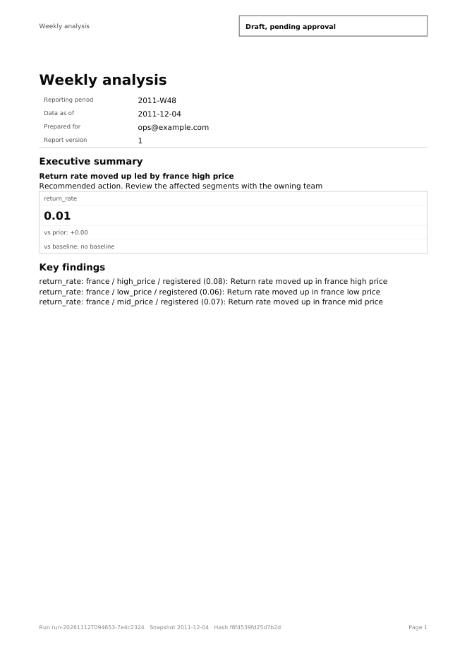
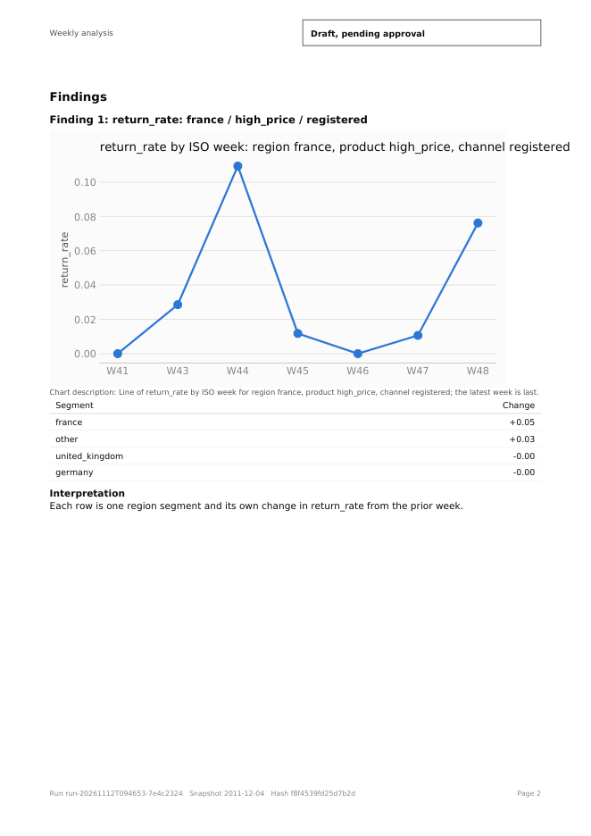
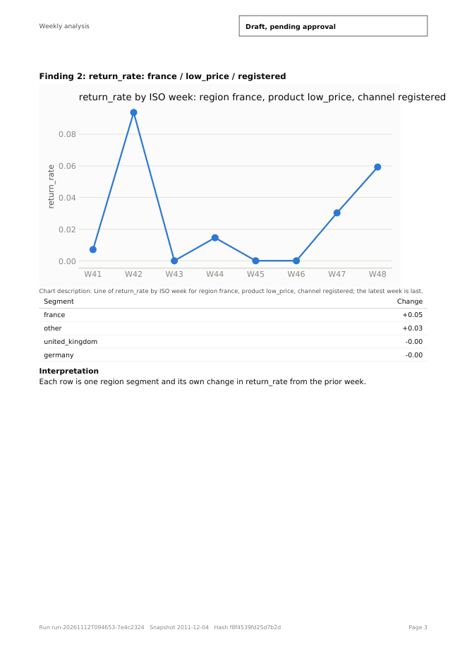
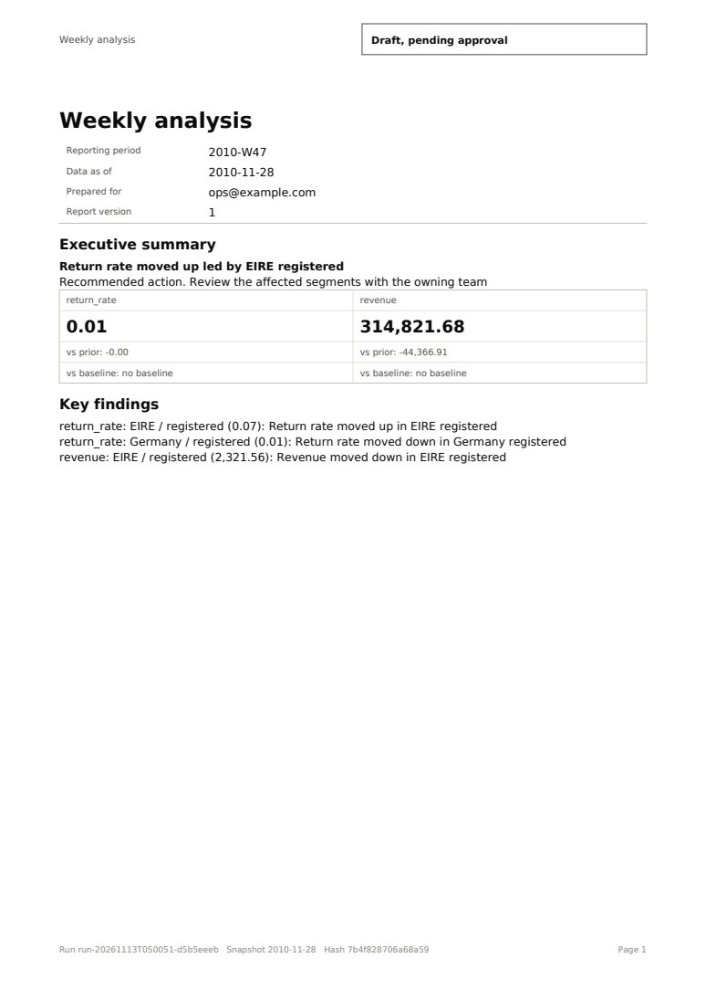
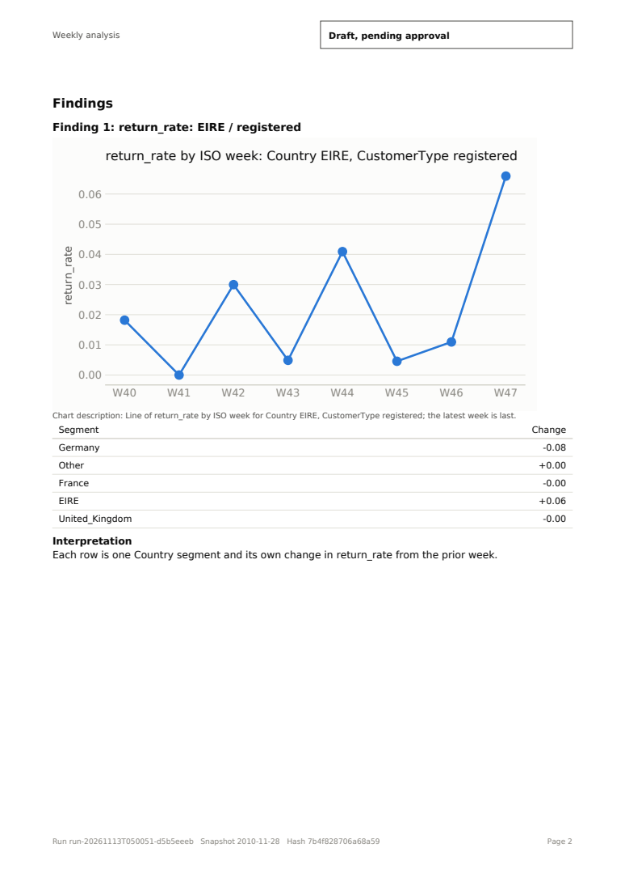
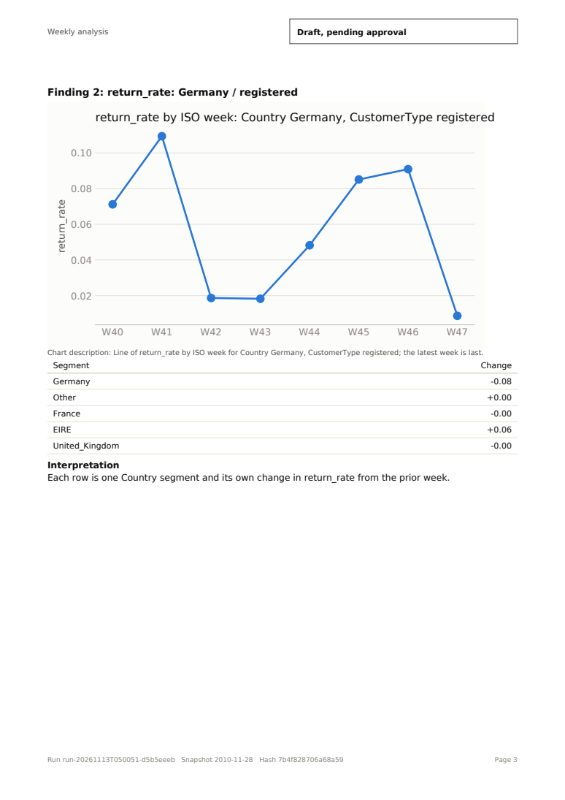

# Weekly Analyst

**Drop a CSV in a folder. Do nothing else. If something material changed, a stakeholder-ready PDF appears. If not, it stays quiet.**

Weekly Analyst is a data analyst agent that sits next to a file you replace every week. It runs on your machine, on CPU, with MiniCPM-V 4.7 1B in full precision (f16, no quantization) plus a small LoRA we trained. I built it for the MiniCPM Spark Program, On-Device Agent Challenge.

- Demo video (90 s, with sound): [media/weekly-analyst-demo.mp4](media/weekly-analyst-demo.mp4), also embedded on https://gpa-n.github.io/weekly-analyst/. Updated 2026-11-12: it shows the round 2 LoRA (`lora3`), the held-out scores, the first real-data test and the current limits.
- Live demo: https://huggingface.co/spaces/ewin-reg/weekly-analyst (a spike or drop scenario takes about 5 minutes on the Space's CPU; a quiet week takes seconds)
- Example reports: https://gpa-n.github.io/weekly-analyst/
- Model (the `lora3` GGUF and the earlier edits): https://huggingface.co/ewin-reg/MiniCPM-V-4.7-1B-weekly-analyst-edit

|  |  |  |
|---|---|---|

## The pitch in three sentences

Most AI analyst demos let the language model write the numbers, and a fluent report with one wrong figure is worse than no report. Here the model never touches a number. Code detects the change, runs the queries, draws the charts and fills every table, and an independent recompute step checks each figure before a person approves the send. The model picks which analysis to run and writes the words around the evidence.

## What happens each week

1. **Detect.** Code scores every metric and segment for the newest week (z-score, drift, CUSUM, validation checks, blended by rank) and keeps at most 3 alerts per ISO week.
2. **Stay silent if nothing material changed.** On a quiet week the agent makes no model call and sends nothing.
3. **Plan.** MiniCPM picks a tool and its parameters for each finding (named, parameterised queries; no SQL in the plan).
4. **Investigate.** Code runs the queries on a Parquet snapshot in a locked-down DuckDB.
5. **Draft.** MiniCPM writes headline, recommended action and one "so what" per finding, in words only. A digit in model text is rejected.
6. **Check.** A separate recompute verifies every number in the PDF, scans the PDF for links, scripts and embedded files, and re-checks the stamped file before sending.
7. **Approve.** A person approves (needs a terminal or a token file). Sending is code-only.

## Why MiniCPM, and what it actually does here

MiniCPM-V 4.7 1B (f16) runs locally through llama.cpp. It selects tools and parameters for each finding and writes the narrative, and code checks its output. The model is small enough for CPU and no data leaves the machine. We use only the text path: the vision projector did not load in llama-cpp-python, so we make no vision claims.

## Measured, not promised

| What | Result |
|---|---|
| Real model, quiet week | silent in about 1 s |
| Real model, spike or drop week | PDF draft in about 195 s on a 2-vCPU Colab, about 5 min on the Space; approve re-renders, re-checks and writes it to the sent folder |
| Peak memory | 5.2 GB |
| Test suite (full project) | 659 passed, 2 skipped, 0 failed on 2026-11-13 (includes 5 new tests for bugs found on real data) |
| First weight edit (16,384 values, no training; superseded by the LoRA), held-out plans, 80 tasks, no grammar | 64/80 to 80/80; a random edit of the same size stayed at 64/80 |
| Small LoRA, round 2 (`lora3`), scored once on held-out seeds 400 to 439 (deployed on the Space) | plans 80/80, drafts 80/80 and 40/40 on each of six variants without a grammar, including two held-out reworded instructions (unedited model: 65/80, 0/80, 0/40 each) |
| First real-data test (UCI Online Retail, about 540,000 invoice rows, T4, model output unconstrained) | valid plan and draft each time; after we fixed a bug in our own number check, a full report for 3 of 3 weeks (it halted on all 3 before the fix) |
| Change detector, holdout recall at the quiet gate | 0.21 (95% interval 0.13 to 0.30), not good enough yet, see below |

## The earlier weight edits (superseded by the LoRA)

Before the LoRA we tried to fix the model without training. The first edit changed 16,384 values (about 0.001% of the model) in two MLP layers. The direction came from the agent's own good and failing plan outputs, the columns were ranked by attribution, and the settings were chosen on separate dev seeds. On 80 held-out tasks plans went from 64/80 to 80/80 with no grammar, and a random direction of the same size did nothing. It left drafts at 0/80, because the draft prompt never shows the schema and the base model invents keys. The Space used this 66 KB patch (`assets/edit_patch.npz`, applied to the official f16 GGUF) until 2026-11-12. It still runs with `WEEKLY_ANALYST_LORA=0`.

A second, closed-form MEMIT-style edit of `down_proj` in six layers took drafts from 0/80 to 80/80 on held-out seeds 100 to 139. With the plan edit it scored 80/80 plans and 75/80 drafts on fresh seeds 200 to 239 (base 62/80 and 0/80, a random edit of the same size the same as base). It moves about 2.6% of those matrices' norm, much more than the first edit. It held on new data, one item and renamed metrics (40/40 each), scored 32/40 with the production re-request line, and fell to 0/40 when the instruction text was reworded. A refit on the model's own samples also failed. We never shipped it. The LoRA below fixed drafts and the reworded instructions. Details and failed attempts are in `results/wsp-draft-edit.md`; method and limits are in the [model card](https://huggingface.co/ewin-reg/MiniCPM-V-4.7-1B-weekly-analyst-edit), and the scripts are in `edit/`.

## Problems we hit, and what fixed them

| Problem | What we did |
|---|---|
| Fluent reports can carry wrong numbers | Code supplies every number. A separate recompute checks each one, a digit in model text is rejected, the PDF is scanned and the stamped file is re-checked before send. |
| Untrusted CSV labels can carry prompt injection | Segment labels become letters-only hash codes before the model or the PDF sees them. The plan never contains SQL, sending is code-only, and approval needs a terminal or a token file. |
| First real-model runs halted: unknown query name, wrong `segment_col`, digits in drafts | The plan prompt lists the query catalogue with a worked example, a parameter check re-prompts with the exact problem, and draft evidence is words only (direction, largest segments, no numbers). |
| Free-form SQL from a 1B model is risky | Named, parameterised queries are the main path. Free SQL is the last resort under a GBNF grammar, in DuckDB locked down in the right order (autoload off before lock). |
| Quantization hurt quality | Full precision f16 everywhere, no quantized model. |
| Our own finetune vs the official model | Compared on the same tasks; the official model won on length and out-of-domain scores, so we did not adopt the finetune. |
| Report layout bugs: footer overlapped the page number, raw item keys in findings | Shortened the footer hash to 16 characters and rendered readable segment names. |
| The vision projector would not load in llama-cpp-python | Dropped the vision claim; the agent uses the text path. |
| Colab VMs died during long runs and took results with them (twice) | Long jobs run detached and push every result to a private Hugging Face dataset; a lost VM costs one trial. |
| A plain weight edit did nothing (alpha 1); strong or wide edits broke the model (0/40 plans) | Searched strength and width on dev seeds; the working edit is narrow (8 columns, 2 layers, alpha 6), then validated once on held-out tasks against a random-direction control. |
| The converted edited GGUF would not load in llama-cpp-python 0.3.36 | Ship the edit as a patch on the official GGUF and verify it matches the converted file on the edited tensors. |
| The Space repo has a 1 GB cap and the model is 2 GB | The app downloads our ready-made `lora3` GGUF from the model repo at start (the first edit was a patch applied to the official GGUF at start). |
| ZeroGPU Space: the agent run was killed with "GPU task aborted" and the host reported 192 CPUs, which thrashed llama.cpp (545 s) | The agent runs on CPU outside the GPU time cap with threads capped at 8; one tiny `@spaces.GPU` function stays so the Space starts. |
| Gradio Spaces could not be created through the API on a free account (402) | The Space was created in the web UI and updated through the API. |
| Drafts scored 0/80 without a grammar and the first edit did not help | Printing raw outputs showed that the draft prompt never shows the schema, so the model invents keys. Direction edits stayed at 0/40. A closed-form edit reached 80/80 on held-out drafts but failed on a reworded instruction. A LoRA trained on many wordings fixed drafts and wordings (see below). |
| Detector recall was 0.21 on holdout | Diagnosed on dev seeds: ranking alone reaches 0.61 recall at the top 3 for a 1.5x outlier (0.65 for z-score alone), so the strict minimum-change gate costs most of it. Not fixed yet. |

## Tune/score split and the LoRA (rounds 1 and 2, 2026-11-11 and 2026-11-12)

We reran the weight-edit work with a stricter protocol: edits are fitted on seeds 0 to 19, configs are chosen on seeds 20 to 39 (plus separate dev wordings), and each final candidate is scored once on never-touched seeds 300 to 339 through a ledger that refuses a second run of the same candidate. Prompt wordings are split three ways (fitted, used for selection, held out for scoring only).

Measured once per candidate on never-touched scoring seeds (no grammar, greedy, 80 tasks, 40 for each variant). Round 1 was scored on seeds 300 to 339, round 2 on fresh seeds 400 to 439 (the first seeds were spent).

| | Plans | Drafts, plain wording | Renamed data | Repair line | One item | Reworded, no field names | Held-out wording `reword_b` (no field names) | Held-out wording `reword_c` |
|---|---|---|---|---|---|---|---|---|
| Base model (seeds 400 to 439) | 65/80 | 0/80 | 0/40 | 0/40 | 0/40 | 0/40 | 0/40 | 0/40 |
| First LoRA (rank 8 on every `down_proj`, 2 epochs; seeds 300 to 339) | 80/80 | 80/80 | 40/40 | 40/40 | 40/40 | 0/40 | not scored | not scored |
| **Round 2 LoRA `lora3`** (same recipe, 4 epochs, many more instruction wordings; seeds 400 to 439) | **80/80** | **80/80** | 40/40 | 40/40 | 40/40 | 40/40 | 40/40 | 40/40 |

Wilson 95% lower bounds are about 0.95 for 80/80 and 0.91 for 40/40. `reword` was added to the training wordings by decision, so it only tests new seeds; `reword_b` and `reword_c` were never trained on.

What changed in round 2: the first LoRA copied the `direction` key from the evidence when the instruction named no JSON fields. Adding training wordings that name no field fixed two of three held-out dev wordings; the third wrote `recommended_step` (the instruction's own word) instead of `recommended_action`, and eight synonym wordings plus one more epoch fixed it. We did not try the gradient-free LP edit on this problem, because the LoRA already passed.

The Space now runs `lora3` (as an f16 GGUF, `MiniCPM-V-4_7-1B-weekly-analyst-lora3-F16.gguf` in the model repo; checked in llama.cpp on a T4 on unspent seeds 500 to 511: 24/24 plans, 24/24 drafts and 8/8 under `reword_b`, against official-GGUF drafts 0/8). Set `WEEKLY_ANALYST_LORA=0` to fall back to the older 16,384-value plan edit. The first LoRA file stays in the model repo. A closed-form, gradient-free edit with a larger scale fixed the no-field-name wording on dev (20/20) but dropped the plan step to 12/40 (base 36/40), so it was not used. Details, configs and the papers we read are in [results/tune-score-lora.md](results/tune-score-lora.md).

### A first real-data test

We ran the real pipeline on the UCI Online Retail sheet (about 540,000 invoice rows, converted to our weekly CSV; registered or guest customers as the channel, cancellation invoices as returns) with the `lora3` GGUF on a T4 and the model output unconstrained. The model wrote a valid plan and draft each time. The pipeline halted on all three weeks because of a bug in our own code: the attribution rows showed a segment's contribution to the change, but the independent number check recomputes the segment's own change and refuses segments with fewer than 30 rows. We now show each segment's own change and leave out segments below that size (`attribution_rows` in `src/weekly_analyst/systems/report_findings.py`, covered by two unit tests in `tests/test_report_attribution.py` of the GitHub repo). After the fix, all three weeks produced a full report. This is one dataset, one run per week, not a quality score.

Example output for the week of 2011-12-04 (ISO week 2011-W48), made with `scripts/online_retail_to_csv.py` and the `lora3` GGUF, model output unconstrained: [report PDF](examples/online-retail-2011-w48.pdf) and the model's two raw replies, plan and draft ([JSON](examples/online-retail-model-replies.json)). The draft is formulaic ("Return rate moved up in france high price", the same sentence shape for each segment); the numbers in the report come from code and were recomputed, not from the model. It shows that the format and the checks hold on real data, not that the analysis is insightful.

|  |  |  |
|---|---|---|
 An earlier try on the Tableau Superstore sample stayed silent because its segments were far below the size minimum.

### A second real Excel file (UCI Online Retail II, 2026-11-13)

We pointed the app at a second real workbook, the UCI Online Retail II sheet for 2009-2010 (525,461 invoice lines, 53 weeks), on a T4 with `lora3` and unconstrained model calls. It found three bugs of ours, now fixed and covered by tests:

- A raw `.xlsx` halted with "file is not valid UTF-8". It now says the file is an Excel workbook and must be exported as CSV first.
- A first run crashed with `unable to open database file` when the work folder did not exist yet. The store now creates it.
- Our number check and the model-path calculation looked for a column literally named `date` and ignored `date_column` from the metrics file. All four weeks failed until we fixed it. After the fix, 4 of 4 weeks produced a full report.

I recomputed the headline numbers of one report from the CSV and they match the PDF exactly. The draft text is as formulaic as before. Details: [results/real-excel-online-retail-ii.md](results/real-excel-online-retail-ii.md). Example: [report PDF](examples/online-retail-ii-2010-w47.pdf), the [model's replies](examples/online-retail-ii-model-replies.json), the converter `scripts/online_retail_ii_to_csv.py` and the metrics file `examples/metrics_online_retail_ii.yaml`.

|  |  |  |
|---|---|---|

## Honest limits

- Detection: recall 0.21 on the holdout replay at the quiet gate (the bar was 0.80), and 14% of quiet weeks raised an alert. We know why, we have not fixed it.
- Not done yet: injection corpus against the real model, a second person scoring brief quality, a reliability report, a general-capability regression check of the LoRA, CUDA on the Space (the code supports it; it did not run on the GPU there).
- All scores are on synthetic tasks from one generator, without a JSON grammar, greedy, 80 tasks scored once per round. In production the agent uses a grammar and retries, so the real gain is probably smaller. The first LoRA failed an instruction that did not name the JSON fields (0/40); round 2 fixed that. Dev wordings were written in the same session as the training wordings, so dev was optimistic; the fresh-seed score is the clean number.
- The Space runs the round 2 GGUF; its llama.cpp check used unspent seeds 500 to 511 plus a held-out wording. The real-data test used one dataset and was not run on the Space.
- Free SQL: the unedited model got 21 of 30 under a grammar (bar 24), so named queries are the main path. This was not re-measured with the LoRA.
- Real data: two public datasets (UCI Online Retail and Online Retail II). The draft text there is formulaic; the numbers come from checked code. The product reads CSV only, so an Excel sheet must be converted first (`scripts/online_retail_to_csv.py` is one example).
- Chart reading by the vision encoder is not claimed (the vision projector would not load in the runtime used). CPU only on the Space; Apple Silicon speed is untested.
- The scenarios on the Space are synthetic. Nothing is uploaded, and the source file is never modified.

## Run the tests

The full test suite is in `tests/` of the GitHub repo (with `eval/` and `pyproject.toml`): `pip install -e ".[dev]" && pytest`. It uses a stand-in model, not the real one, and takes about 10 minutes on a 12-core machine when split across processes (about 25 minutes in one process). On 2026-11-13: 659 passed, 2 skipped, 0 failed.

## Run it

`pip install -r requirements.txt && python app.py`, or open the Space. With CUDA: `requirements.cuda.txt`. The first run downloads our 2 GB `lora3` f16 GGUF (`MiniCPM-V-4_7-1B-weekly-analyst-lora3-F16.gguf`) from `ewin-reg/MiniCPM-V-4.7-1B-weekly-analyst-edit`. With `WEEKLY_ANALYST_LORA=0` it downloads the official GGUF from `openbmb/MiniCPM-V-4.7-1B-gguf` and applies the old 16,384-value patch; with `WEEKLY_ANALYST_EDIT=0` it uses the official file unchanged.

## Layout

- `src/weekly_analyst/`: the agent (extract, validate, detect, plan, investigate, draft, check, outbox, remember), renderer, checks, approve command, `analysis/weight_patch.py`.
- `app.py`: the Gradio demo. `assets/`: the weight patch. `examples/`: sample reports.
- `edit/`: weight-edit and evaluation scripts for Colab. `results/`: raw measurements, including the ones that went badly.
- `docs/`: design document and architecture notes.
